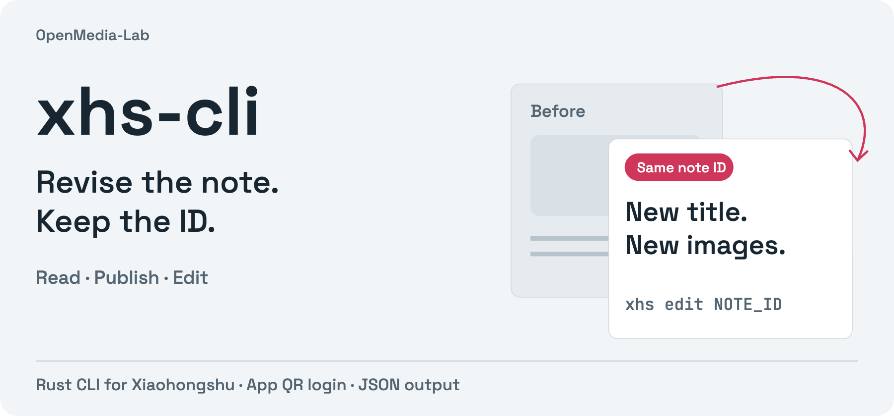

<p align="center"><strong>English</strong> · <a href="README_ZH.md">简体中文</a></p>

<p align="center"></p>

# xhs-cli

**Read, publish and revise Xiaohongshu notes from your terminal.** Native Rust HTTP requests and signing, app QR login, and JSON output. The binary is `xhs`.

[Quick start](#quick-start) · [Edit a note](#publish-privately-then-edit) · [Command guide](docs/usage.md) · [中文](README_ZH.md)

- **Keep the same note ID.** Replace images or video, revise copy, or change visibility; omitted edit fields are preserved.
- **Work with real media.** Image notes, H.264 video with a cover, document attachments and public-video downloads.
- **Script the workflow.** Search, read, inspect your notes and resolve topics with structured JSON.

## Quick start

Requires a current stable Rust toolchain. Build and install from source:

```sh
git clone https://github.com/OpenMedia-Lab/xhs-cli.git
cd xhs-cli
cargo install --path . --locked

xhs login --qr
xhs me
xhs search 'Rust'
```

Scan with the Xiaohongshu app and confirm on your phone. Add `--qr-file ./xhs-login.svg` to export the QR. Browser automation and Python are not required. [Cookie import and session options](docs/usage.md) are also available.

## Publish privately, then edit

Prepare your own `cover.png` and UTF-8 `body.txt`. **This creates a private note on your account:**

```sh
xhs publish --title 'A project worth sharing' --desc-file body.txt \
  --image cover.png --visibility private
```

Use the returned note ID for later changes. These commands update the existing note:

```sh
xhs edit NOTE_ID --title 'A clearer title' --desc-file revised-body.txt
xhs edit NOTE_ID --image cover-v2.png --image detail-v2.png
xhs detail NOTE_ID
```

Omitted images and visibility stay as they were. Supplying images replaces the complete image set. A private note is saved on the platform; it is not a local draft.

## Choose your workflow

| Task | Start here |
|---|---|
| Find and read notes | `xhs search 'keyword'`, then `xhs read 'SIGNED_NOTE_URL'` |
| Inspect your account | `xhs me`, `xhs my-notes`, `xhs detail NOTE_ID` |
| Publish with native topics | `xhs topics 'keyword'`, then repeated `--topic 'Exact name'` |
| Publish or replace video | [Video guide](docs/video-publishing.md): upload → preview → submit once → read back |
| Attach a document or download media | [Full command guide](docs/usage.md) |

Signed note URLs contain access tokens returned by search; arbitrary bare IDs may not resolve. Topic entities and visible `#topic[话题]#` body markers are separate. Video publication uses durable receipts; `check-publish` reconciles uncertain results without posting again.

## Before you automate

The CLI uses the platform's web interfaces, which may change. Account checks, moderation and rate limits still apply. It cannot promise unrestricted publishing or recommendation traffic. See [verified behavior and limits](VALIDATION.md).

Sessions default to `~/.xiaohongshu-cli/cookies.json`; keep session files and publication receipts out of Git. See the [login contract](docs/qr-login-verification.md). On ambiguous write failures, inspect your notes before another attempt.

## Contribute

Bug reports are most useful with the command, redacted error JSON, expected behavior and CLI version. Never attach cookies or signing headers. For a patch, start with:

```sh
cargo fmt --all -- --check
cargo test --locked
```

## Works with

[postdeck](https://github.com/OpenMedia-Lab/postdeck) adapts articles into cards; separate CLIs handle platform operations: [xhs-cli](https://github.com/OpenMedia-Lab/xhs-cli), [zhihu-cli](https://github.com/OpenMedia-Lab/zhihu-cli), [x-cli](https://github.com/OpenMedia-Lab/x-cli). Explore the rest of [OpenMedia-Lab](https://github.com/OpenMedia-Lab).

## License and origins

[Apache-2.0](LICENSE), with separately licensed components. This Rust implementation draws on [jackwener/xiaohongshu-cli](https://github.com/jackwener/xiaohongshu-cli); see [NOTICE](NOTICE) and [LICENSE-xhshow](LICENSE-xhshow) for attribution.
