# Video publishing contract (2026-10-26)

## Observed official source

The implementation was checked against the public [creator publishing page](https://creator.xiaohongshu.com/publish/publish), using the scripts linked by that page:

- `index.db249e1e.js`: uploader, ROS channels, `generatorID`, and `queryTranscode`.
- `project-publish-vue.d9cb3b70.js`: `constructData`, cover conversion, deep snake-case request conversion, activity association, and the publication endpoint.
- Public scripts are served from `https://fe-static.xhscdn.com/formula-static/ugc/public/resource/js/`.

These are observed private web contracts and can change. No browser session, cookies, upload tokens, user-specific receipts, or full web bundles are committed.

```mermaid
flowchart LR
  file[Local H.264 MP4 and cover] --> inspect[Native bounded MP4 inspection]
  inspect --> permit[Creator video permit]
  permit --> ros[Streaming HTTPS PUT to ROS]
  ros --> receipt[Retained material receipt]
  receipt --> status[Read processing status]
  receipt --> preview[Resolve exact topics and active campaign]
  preview --> payload[Local dry-run payload]
  status --> ready{First frame ready}
  payload --> review[Human reviews final content]
  ready --> journal[Create exclusive publication journal]
  review --> journal
  journal --> post[Single POST; retries disabled]
  post --> accepted[Accepted but unverified]
  post --> unknown[Unknown outcome; no resend]
  accepted --> check[Creator detail and business-bind readback]
  unknown --> candidates[Read note-list candidates; never republish]
  candidates --> check
```



## Wire protocol

| Step | Method and path | Relevant fields |
| --- | --- | --- |
| Video permit | `GET /api/media/v1/upload/creator/permit` on creator | `biz_name=spectrum`, `scene=video`, `file_count=1`, `version=1`, `source=web` |
| Video bytes | `PUT https://<uploadAddr>/<fileIds[0]>` | `X-Cos-Security-Token`, `Content-Type: video/mp4`, streamed body |
| Video ID | Prefer upload response `x-ros-video-id`; fallback `GET /web_api/sns/capa/postgw/videoid` on edith | `file_key`, `biz_name=217`; preserve returned ID |
| Canonical file ID | Prefer upload response `x-ros-file-id` when present | Preserve the permit file ID as an alias in the material receipt |
| Processing | `GET /web_api/sns/capa/postgw/query_transcode` on edith | `video_id`, `need_transcode=false`, `level=14`, `resource_type=0` |
| Cover | Existing image permit and image PUT | Explicit file ID, width and height |
| Campaign list | `GET /api/galaxy/v2/creator/activity_center/list` on creator | `sort=1`, `type=1`, `source=3`, `topic_activity=0` or `1` |
| Publication | `POST /web_api/sns/v2/note` on edith | `common.type=video`, `image_info=null`, `video_info` |
| Readback | Creator note detail and business-bind endpoints | Video file ID, cover, title, body, topic IDs, privacy, campaign relation |

Only advertised ROS hosts under `xiaohongshu.com` or `xhscdn.com` are accepted. HTTP permit addresses are upgraded to HTTPS. Redirects and automatic HTTP retries are disabled. API responses with explicit failure or nonzero platform codes fail, even if another field resembles success.

The official video payload uses `fileid` and `file_id`, `format_width`, `format_height`, `composite_metadata`, `timelines`, `cover`, `chapters`, `segments`, `summary`, `chapter_sync_text`, and `entrance=web`. A supplied cover has both file-ID forms, dimensions, and `frame={ts:0,is_upload:true,is_user_select:false}`. The native initial path uses one unmodified segment at speed 1 with duration in seconds. It does not implement editing, slicing, HEVC transcoding, multiple video tracks, rotations, AI covers, or scheduled publication.

The body is transmitted as its exact UTF-8 string. JSON transport escaping is decoded normally; it does not turn newlines into literal backslash characters. Topics are separate `common.hash_tag` entries with exact `id`, `name`, and `type=topic`. The user-provided visibility becomes `privacy_info.type`: public `0`, private `1`.

The CLI does not silently rewrite the supplied body when resolving topics. For
visible inline topic links, retain the publisher's `#话题名[话题]#` markers in
the reviewed description as well as the exact topic entities. Both forms were
observed together in creator detail for an existing note.

`--declaration ai-synthesis` selects the publisher's native “笔记含AI合成内容”
content type. The official enum is `AiSynthesis=2`; its value is stored inside
the stringified business binds as `userDeclarationBind:{origin:2}`. It is
independent of the cover recommendation's `isAiCover`, topic entities and body
text. Omission preserves the prior behavior and adds no declaration. Dry-run
exposes the exact binding; readback requires the requested origin to survive.
This option is not a claim that the platform will approve or award the note.

## Readback identity and formatting

The publication journal retains material evidence separately from the exact
submitted payload. The live service can return canonical video and cover IDs
that differ from upload-permit aliases. Exact file IDs use the normal strict
comparison. For rewritten IDs, the original material must match the submitted
IDs; the original video MD5, independent video ID, source/display dimensions and
duration must all match. Duration allows the observed server rounding by at most
one second. The cover's `original` resource is fetched with a separate client
without session authentication, redirects or retries, restricted to HTTPS
`xhscdn.com` hosts. Only a complete HTTP 200 response up to 32 MiB is accepted;
SHA-256, MD5, byte count, decoded dimensions and returned dimensions must match
the material receipt. Incomplete or missing evidence fails verification.

The report names the comparison method and both submitted and canonical IDs.
ID substitution occurs only in an in-memory verification copy; the journal's
submitted payload is never rewritten. `check-publish` does not update the journal
or resend a POST.

The service also collapsed consecutive LF runs to one LF in all three live
publications. Readback accepts only the exact body or that specific transformation,
with no other character changes. The latter sets `description_exact=false`,
`normalization=platform_collapsed_blank_lines`, a format warning and newline
counts. It does not report byte-for-byte formatting equality. Changes to single
line breaks, other whitespace or text fail verification.

## Campaign evidence

The live creator list identified **AI替我说**, activity ID `45151`, with reward text “用AI讲知识，等你来投稿”. Its [official activity page](https://fe.xiaohongshu.com/ditto/vincent/2d2b41a732ac40dca0a54302674a9636?fullscreen=true&resource_instance_id=332334&naviHidden=yes&source=creator_activity_center) and PC post link reference that ID. Exact topic entities returned by creator topic search were:

| Name | Entity ID |
| --- | --- |
| AI替我说 | `6acca064000000002302cc07` |
| 用AI讲知识 | `6aca516f000000002200ce88` |

The campaign component is independent of those topic entries. The official publisher converts the selected live record to:

```json
{"type":"ACTIVITY_COMPONENT","relationList":[{"bizType":"ACTIVITY_COMPONENT","bizId":"45151","extraInfo":"{\"id\":\"45151\",\"name\":\"AI替我说\",\"start_time\":1792148400000,\"end_time\":1796036400000}"}]}
```

This relation is inside `common.business_binds` → `optionRelationList`; that outer business value is itself a JSON string. Dates above are one observed creator response, not a permanent campaign rule. The implementation fetches current data when `--activity` is supplied. Displaying a campaign in this API and transmitting its relation do not prove final acceptance or eligibility.

## Updating the original note

The current official editor supports replacing media while retaining `noteId`.
Uploading a replacement sets `isReplaceVideo`; `constructData` serializes it as
`video_info.replaced_video=true` and retains `common.note_id`. The update method is
`PUT /web_api/sns/capa/postgw/note/update`, not the new-note POST. This is an
observed editor contract; individual accounts can still encounter permission or
review errors.

`edit --video-info` accepts a completed reusable material receipt with the new
video and explicit cover. It preserves omitted common fields, native topics,
business bindings, complete privacy and unknown extension fields. Known old-source
stream URLs, derived media metadata and cover URLs are removed before the native
replacement fields are applied. A body-only video edit retains the current
media/cover/chapters and sets `replaced_video=false`.

`--desc-file` preserves UTF-8 body line breaks; it conflicts with `--desc`.
`--dry-run` only reads creator detail/bindings and prints the exact original-ID
payload. It cannot be combined with an image upload. Real video replacement
requires a new `--receipt`; a receipt supplied for another edit also enables the
durable single-PUT path. Legacy edit calls without new flags remain compatible.

The journal saves original detail, target ID, exact payload and replacement
material before the single PUT. The original ID, target ID and payload ID must
agree. Explicit different IDs in a response produce an unknown outcome; recovery
always reads the original ID, never title candidates or another submission.
`check-publish` verifies the changed media/copy on that ID without rewriting the
journal or sending an update. Contract tests, three cached real-note previews and
three actual explicitly approved original-ID replacements passed. Each real
replacement used one PUT and retained its original ID, topics, activity, public
visibility and native declaration; the changed video/cover fingerprints and body
were read back, followed by an authenticated public-feed read.

An observed note remained enabled/public and readable after recommendation/search
restriction. Its creator-list entry exposed `punish_reason` and `modify_advice`
while detail did not. Inspect both surfaces and report timestamps; an accepted
edit or a readable public feed is not proof of lifted moderation or activity
credit. In that case the notice specifically cited an outbound article URL. After
the approved correction, its list status changed from `tab_status=3/ref_tip=2`
to `1/0` and punishment/advice fields were absent. This reports the observed
state after editing; later distribution and activity credit remain unverified.

## Evidence and remaining limits

- Preserved baseline: 33 tests passed before the video changes, including existing document, portrait-image, share-link and MP4-download work.
- A 2,344-byte, 0.4-second H.264/AAC MP4 and explicit PNG cover uploaded through the main ROS channel; a later processing query returned `has_first_frame=true`.
- A 3,205,042-byte, three-second synthetic H.264/AAC MP4 uploaded through `ros-upload-d4.xhscdn.com`. This exceeds the official SDK's 3 MiB slicing threshold; the native streaming single PUT and subsequent first-frame query succeeded.
- Exact topic search, current campaign lookup, video-ID fallback and local dry-run generation were exercised with the existing session. A payload with both topics, the activity relation, private visibility and three actual newlines was inspected.
- The native AI content declaration was checked against the same official
  publisher's enum, business-bind builder and UI label. Regression tests exercise
  the real CLI dry-run and reject missing/changed declarations during readback.
- A read-only reconciliation probe caught a mismatch with current creator list
  responses: titles are returned as `display_title`. Candidate lookup now accepts
  that field, with a legacy `title` fallback; it still returns candidates only and
  never resends a submission automatically.
- After explicit approval of all three complete films, covers and final metadata, three 1080×1920 H.264/AAC videos (approximately 186, 194 and 257 seconds) were publicly posted once each. All three passed installed-CLI creator readback, original video identity and exact cover-byte checks; authenticated public-feed reads also returned each matching video note. Topics, public visibility, activity 45151 and declaration origin 2 were retained. The server collapsed nine submitted LF characters to five; all other body characters matched.
- Local verification passed 61 tests, formatting, strict Clippy and a locked release build. The installed release SHA-256 matched the build. Private journals, approved metadata and original material receipts remain outside this repository.
- Campaign association is verified. Effective task count, reward eligibility and vouchers are not: the available task API and activity landing page did not expose a reliable campaign-specific counter.
- No video near 1 GiB/four hours, interruption during a large transfer, cross-platform installation or campaign acceptance was tested. These limits are validation boundaries, not success claims.

Local publication receipts are created exclusively with private permissions. Initial creation syncs the file and its parent directory on Unix; updates write and sync a private temporary file before an atomic rename, preserving the prior recoverable payload on a failed write. Material PUTs require 2xx status; redirects are never interpreted as completed uploads. The native cover surface is limited to JPEG/PNG and 32 MiB; this is a local conservative constraint, not a claim about the server’s main-cover size limit. They are an operational safeguard, not a server idempotency key: using a different receipt path can still create a duplicate. Never do that to recover from an unknown result. `check-publish` returns a verification report without rewriting the original journal.
